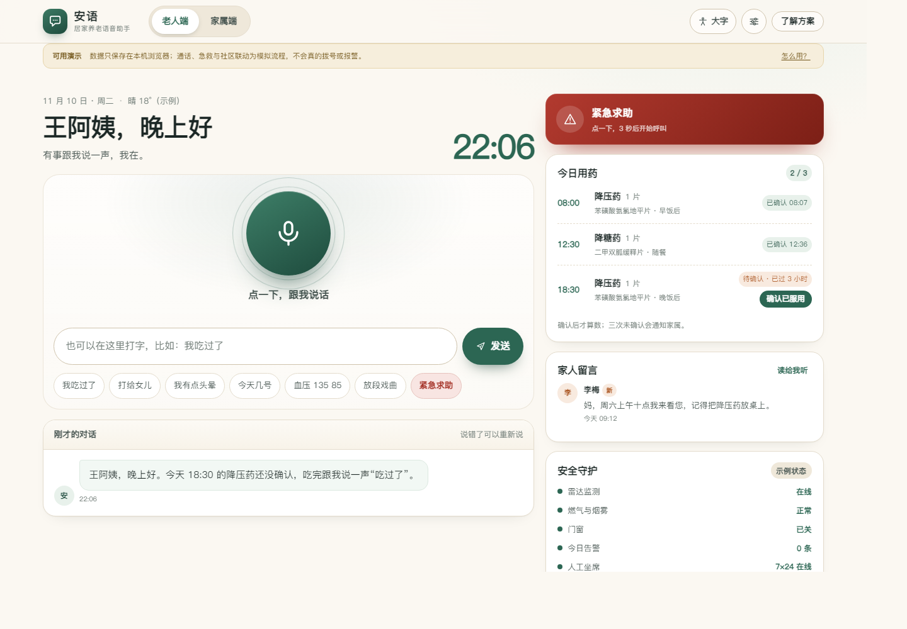

# 安语 · 居家养老语音助手（可用演示）

一个**可以真的操作**的居家养老语音服务网站：说话或打字就能确认吃药、记录血压、给女儿打电话、发起紧急求助；切到家属端，能看到告警、周报、留言和授权开关；再切到社区端，同一条求助会变成一张工单，按 60 秒响应时限被接单、到场、转 120、结案。

它不是一张产品宣传页，也不是静态原型图——页面里的按钮、表单、语音播报、倒计时、家属端数据和社区工单都是真的在跑。老人端、家属端、社区端**共用同一份本机数据**，刷新不丢，跨标签页自动同步。



> 产品与方案原名：**AI 语音养老服务助手**。网站用「安语」作为展示名。
> 这是本地演示：不连接云端大模型，不真的拨号，也不替代 120。详见「已知限制」。

---

## 一分钟试用手册

1. 打开首页，右上角可以先点「**大字**」放大正文。
2. 点中间的大圆钮，说 **“我吃过了”**；或者点下面的「我吃过了」快捷按钮。
3. 说或点 **“血压 135 85”**，助手会复述一遍，点「对，记上」写入趋势。
4. 右侧「今日用药」里点 **“确认已服用”**，看右上角计数和家属端一起变化。
5. 点红色 **“紧急求助”**（桌面在右侧顶部，手机固定在底部）：3 秒倒计时 → 自动走完家属 → 社区 → 120 的演示联动。
6. 切到右上角「**家属端**」：看告警、本周报告、血压曲线、用药记录；发一条留言，再切回老人端听它读出来。
7. 点右上角 **设置（滑杆图标）**：大字、高对比、语音播报、语速，以及「重置演示数据」。
8. 打开「**社区端**」（页脚或 `community.html`）：刚发起的求助已经在待接单里，试着 **接单 → 到场 → 转 120 → 结案**，看时间线怎么记账、SLA 倒计时怎么变红。

> 没有麦克风也能用：输入框里打字，效果完全一样。语音只是入口，不是唯一路径。

---

## 怎么打开

### 方式一：直接双击（最简单）

双击 `index.html` 即可。文字输入、用药、SOS、家属端全部可用；语音朗读通常也能用。

**麦克风可能被浏览器限制**：直接以 `file://` 打开时，Chrome / Edge 往往不允许语音识别。遇到这种情况，用方式二，或在页面下方打字。

### 方式二：本地服务器（推荐，语音识别更稳）

Windows 可以直接双击 **`start-server.cmd`**，会自动用 Python 起服务并打开浏览器。

也可以手动执行任意一条：

```powershell
# Python
python -m http.server 8000

# 或 Node.js（npx 已安装时）
npx serve .
```

然后打开 <http://127.0.0.1:8000/>。麦克风权限会正常弹出。

### 方式三：部署到任意静态空间

把整个 `website/` 目录上传即可（无构建步骤、无后端）。语音识别需要 **HTTPS**（或 localhost），所以正式部署请配好证书。

---

## 页面地图

| 文件 | 作用 |
|------|------|
| `index.html` | **可用应用**：老人端 + 家属端 |
| `community.html` | **社区值守台**：工单看板、SLA 倒计时、事件时间线、辖区名册、运营指标 |
| `about.html` | 原产品方案展示页：为什么做、老人一天、交互脚本、十大模块、路线图 |
| `docs.html` | 设计方案全文（10 章 · 34 节 · 28 张功能表），带侧边目录与打印样式 |
| `assets/app.js` | 应用逻辑：对话、用药、血压、SOS、家属端、持久化 |
| `assets/app.css` | 应用界面样式 |
| `assets/console.js` | 社区端逻辑：工单状态机、SLA 计算、名册与指标 |
| `assets/console.css` | 社区端样式 |
| `assets/style.css` | 共享设计令牌与基础组件，也供方案页/文档页使用 |
| `assets/site.js` | 方案页与文档页的交互：适老化、导航、语音脚本演示 |
| `assets/docs.js` | 文档页的 Markdown 渲染与目录 |
| `preview.png` | 首页截图 |
| `start-server.cmd` | Windows 一键本地预览（需 Python） |

---

## 功能清单

### 老人端

- **语音 / 文字对话**：浏览器语音识别（zh-CN）+ 语音合成；识别失败会说明原因并引导到文字输入。
- **服药确认**：今日三次用药，显示“已确认 / 待确认 · 已过 N 小时 / 未到时间”，确认后写入记录，家属端同步。
- **血压记录**：说“血压 135 85”或手动填写，助手复述确认后入档，家属端趋势图更新。
- **亲情通话**：说“打给女儿”或点快捷按钮，进入模拟通话，挂断后计入本周通话次数。
- **紧急求助**：3 秒倒计时可取消；加速演示家属 → 社区 → 120 三级联动，附应急信息卡，事件在家属端留痕。
- **家人留言**：看最新留言，点“读给我听”。
- **安全状态**：雷达、燃气、门窗、告警、坐席状态（示例）。
- **大字模式**：一键放大全站，行高与点击区域同步变大。

### 家属端

- **四个数字**：今日用药、待处理告警、最新血压、本周通话。
- **告警中心**：SOS、主诉不适、设备离线等；可标记已处理。
- **本周报告**：用药依从率、血压记录、通话、夜间离床、7 天血压曲线、情绪关键词；标注“只呈现，不下结论”。
- **用药与留言**：查看今日用药状态；给妈妈发留言，切回老人端会语音读出。
- **授权中心**：健康数据、雷达、定位分别授权；撤回后家属端立即隐藏对应数据；“实时监听”永久禁用并说明原因。
- **设备与值守**：在线状态、人工坐席入口、SLA 说明。

### 通用

- 所有数据 **localStorage** 持久化（键名 `anyu.app.v1`），刷新、切角色、跨页面都不丢。
- 「设置」里可切换大字 / 高对比 / 语音播报、调语速、重置演示数据。
- 手机、平板、桌面自适应；支持键盘操作、焦点样式与读屏标签。
- 多标签页同步：家属端或社区端在另一个标签页修改，老人端会自动刷新状态。

### 社区端（`community.html`）

- **工单看板**：按「待接单 / 处理中 / 已闭环」分组，工单来自老人端的求助、语音主诉与设备告警。
- **状态机**：接单锁定责任人 → 标记到场 → 转 120 → 结案；每一步都写入事件时间线，可追溯。
- **SLA 倒计时**：SOS 60 秒、其他告警 5 分钟，超时变红并在概览里报「已超时 N 条」。
- **应急信息卡**：姓名、年龄、住址、基础病、过敏、家属电话（脱敏展示，注明查看留痕）。
- **辖区名册**：独居、慢病、有近期事件的老人按风险排序；含设备在线状态与今日用药进度。
- **运营指标**：本周工单类型分布、响应时长分布、设备在线率。
- **深链**：`community.html?t=<工单号>` 可直接打开某条工单，方便发给同事。

---

## 语音都能听懂什么

对话理解是**本地规则引擎**，不联网、不调用大模型，覆盖演示需要的核心意图。可以直接说：

| 说法 | 结果 |
|------|------|
| 我吃过了 / 我吃了药 | 确认最近一次待确认用药 |
| 今天还有什么药 | 报出下一次待确认用药 |
| 打给女儿 / 我想闺女了 | 进入模拟视频通话 |
| 血压 135 85 | 复述并确认后写入趋势 |
| 我有点头晕 / 心口疼 | 进入“不诊断、转人工”的边界话术；胸痛、喘不上气等红旗症状直接进入求助 |
| 今天几号 / 现在几点 / 天气 | 报时、报日期、示例天气 |
| 放段戏曲 | 显示演示播放器 |
| 救命 / 我摔了 | 直接进入 3 秒求助倒计时 |
| 验证码 / 转账 / 中奖 | 防诈骗提示，并建议打给家人核实 |
| 我有点孤单 / 睡不着 | 陪伴话术，可转亲情通话 |

> 真实产品里，这些意图会由银发 ASR + 方言包 + 大模型与养老知识库共同完成；这里是可离线运行的演示版本。

---

## 数据与隐私

- 数据只写入**本机浏览器**的 `localStorage`，没有后端、没有上传、没有埋点。
- 老人档案、用药、血压、留言、告警都是**示例数据**，可在设置里一键重置。
- 页面明确标注了产品边界：默认不采影像、雷达不成像、家属不能实时监听、四类高风险问题转人工。
- 换浏览器 / 清理站点数据会回到初始演示状态。

---

## 已知限制（请务必知道）

1. **不是医疗设备**：不诊断、不开药、不调整剂量，不替代 120、子女、护工与社区。
2. **不是真的 AI 大模型**：对话为本地规则匹配；没有云端语音识别或 LLM，因此不会“自由聊天”，也不会真正理解复杂长句。
3. **通话、SOS、社区联动是模拟**：不会拨号、不会报警、不会真的派单；界面里已注明“演示”。社区端的接单、到场、转 120 只改本机数据，不会通知任何人。
4. **语音识别依赖浏览器**：Chrome / Edge 支持最好；Firefox 不支持；`file://` 下常被限制，建议用 localhost 或 HTTPS。
5. **语音合成依赖系统中文语音包**：没有中文语音时只显示文字，不影响其他功能。
6. **健康与天气数字是示例**：血压、周报、天气均为演示值，不能用于真实健康判断。
7. **麦克风需要安全上下文**：`http://localhost` 或 `https://`，其他 `http://` 地址浏览器会拒绝。

---

## 二次开发

### 改演示数据

打开 `assets/app.js`，顶部 `seed()` 里是全部初始数据：老人档案、联系人、三次用药、7 天血压、周报基数、告警与留言。改完在设置里点“重置演示数据”即可看到效果（或清掉 `anyu.app.v1`）。

### 加一条语音意图

在 `handleIntent(raw)` 里按顺序加正则分支，例如：

```js
if (/提醒我喝水/.test(t)) {
  addAi('好，下午三点我提醒您喝水。');
  return;
}
```

`addAi(text, actions, opts)` 支持在气泡下挂快捷按钮：

```js
addAi('要不要给李女士打个电话？', [
  { label: '打给李女士', act: 'call' },
  { label: '不用了', act: 'dismiss' }
]);
```

按钮的 `act` 在 `runAction()` 里处理；`opts.kind = 'music'` 会渲染演示播放器。

### 改样式

- 应用布局与组件：`assets/app.css`
- 社区端布局与组件：`assets/console.css`
- 全站配色与字号：`assets/style.css` 顶部 `:root`
- 大字模式由 `html.senior` 控制，高对比由 `html.hc` 控制。

### 改社区端

- 名册数据在 `assets/console.js` 的 `ROSTER` 数组；运营指标在 `BARS_A` / `BARS_B`。
- 工单来自 `anyu.app.v1` 的 `alerts`，字段沿用老人端：`level / title / detail / time / status`，社区端额外读写 `raisedAt / acceptedAt / closedAt / assignee / log`（老人端忽略这些字段，互不影响）。
- 新增动作：在 `act()` 里加分支，注意同步写入 `log`，否则时间线不会留痕。

### 更新设计方案文档

`docs.html` 末尾的 `<script id="md-source" type="text/markdown">` 就是全文源；替换为新的 Markdown 即可，`docs.js` 会重新生成目录、表格与锚点（`## 四、…` → `#s4`，`### 4.2 …` → `#s4-2`）。

---

## 设计与内容依据

- 产品方案：`../AI语音养老服务助手-功能设计方案.docx`
- 纯文本源：`../output/9c36f590-273e-4e04-bef8-d8774210a652/stage1/final_draft.md`
- 视觉：暖米色纸感 + 松柏绿 + 陶土橙，尽量不像医疗器械或监控设备。
- 交互原则来自方案：语音优先、零学习成本、先确认后升级、四类高风险转人工、家属访问有边界。

---

## 无障碍

- 语义化标题、跳转链接、可见焦点、`aria-live` 对话播报。
- 所有按钮都有可读标签；弹层有 `role="dialog"`、焦点管理、Tab 循环与 Esc 关闭。
- 大字模式可放大至 19px 根字号；高对比为纯黑白 + 2px 边框。
- 尊重系统「减少动态效果」设置。

---

## 免责声明

本项目为产品方案的可交互演示，不是医疗器械、急救服务或正式运营产品。页面中的政策、指标与流程来自设计文档，所有数值阈值需在真实试点后校准；涉及医疗、急救、支付与个人信息处理的功能上线前必须完成专项合规评审。
